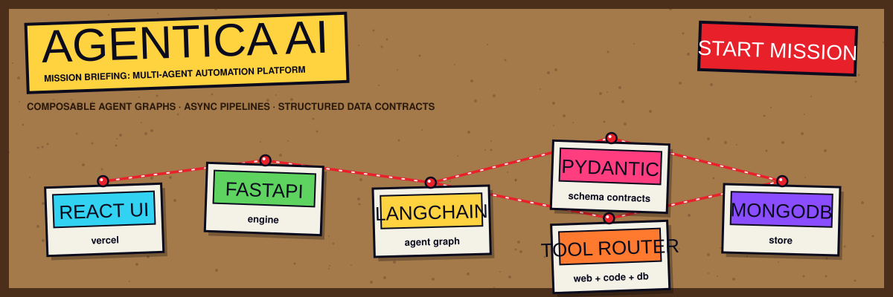
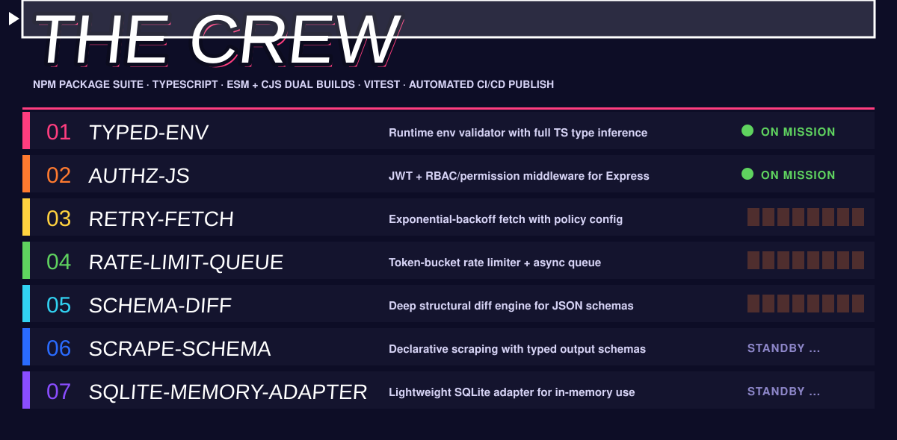
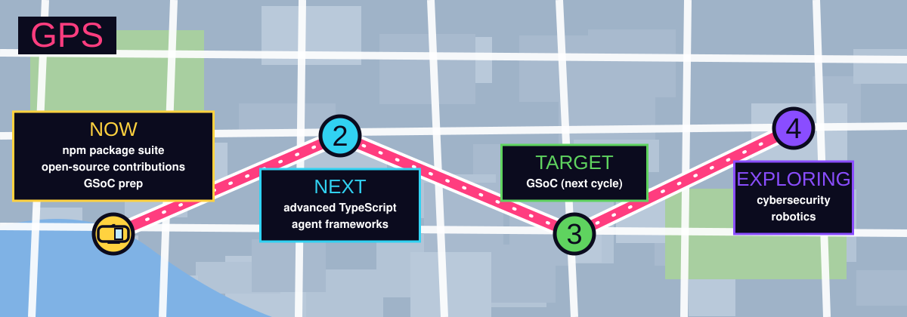
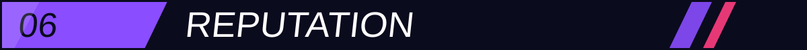
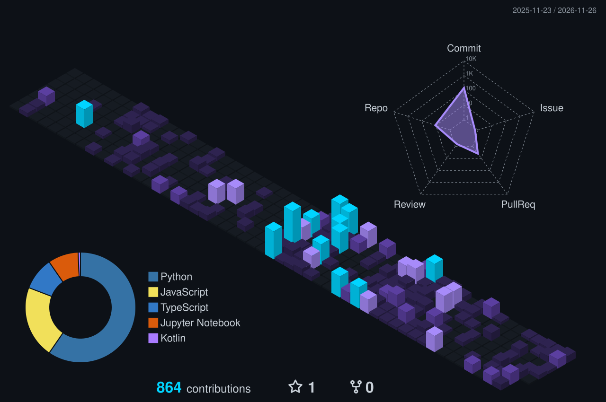

 

<!-- appears after the "Contribution snake" workflow has run once -->
<picture>
  <source media="(prefers-color-scheme: dark)" srcset="https://raw.githubusercontent.com/sougata010/sougata010/output/github-contribution-grid-snake-dark.svg"/>
  
</picture>

| certification | issuer | year | |
|:--|:--|:--:|:--:|
| Software Engineering Virtual Experience | Electronic Arts × Forage | 2025 | [view ↗](https://www.theforage.com/completion-certificates/9PBTqmSxAf6zZTseP/E9pA6qsdbeyEkp3ti_9PBTqmSxAf6zZTseP_68de55396549cc2e44a61432_1759402906224_completion_certificate.pdf) |

